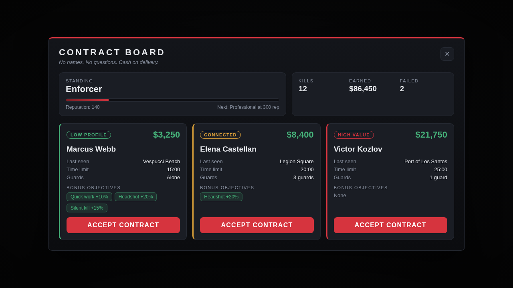
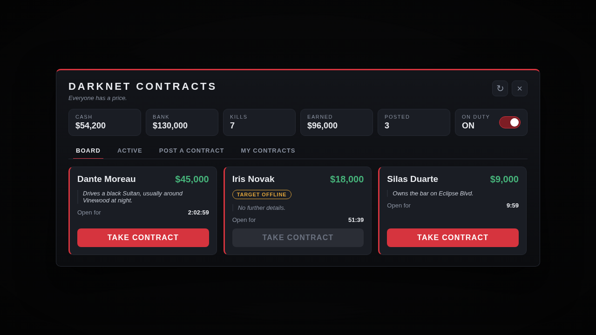

# FiveM hitman job scripts

Two independent resources. Use one or both.

| Resource | Who is the target | What it is |
| --- | --- | --- |
| [`hitman_npc`](hitman_npc/README.md) | NPCs | Take contracts from a broker, hunt an NPC target (with guards), get paid, build reputation. A solo job that needs no other players. |
| [`hitman_players`](hitman_players/README.md) | Other players | Players post contracts on other online players, paying into escrow. Hitmen take the contract, track a search area, kill the target and are paid. |

Both work with **QBCore, Qbox, ESX or no framework at all**. The framework is detected automatically. Neither needs a database, an inventory resource or any other dependency.

<p>
  
  
</p>

*Screenshots are the real pages rendered with sample data.*

## Install

1. Copy the `hitman_npc` and/or `hitman_players` folder into your server's `resources` folder.
2. Add to `server.cfg`:

```cfg
set onesync on                      # required, already on for most servers

ensure hitman_npc
ensure hitman_players

# staff commands (optional)
add_ace group.admin command.hitmannpc allow
add_ace group.admin command.hitmanadmin allow
```

3. Open each resource's `config.lua` and adjust it. Everything is explained in the file, and in each resource's README.

If you use a framework, start these resources **after** it. In `auto` mode the scripts also wait up to 15 seconds for a framework that starts late.

## Requirements

* A current FiveM server build (Lua 5.4, `cerulean` manifest).
* **OneSync** (`set onesync on`). The player contracts need it for the tracker, and the NPC job uses it to verify kills on the server. The NPC job still runs without it, but then trusts the client (the console says so at start-up).

## Before you go live

These were built and checked without access to a live FiveM server, so please spend ten minutes on a test server first:

* **Locations.** The coordinates in `hitman_npc/config.lua` come from well known spots on the map and are refined at spawn time (the script looks for walkable ground near them), but they are not verified in game. Walk to each one, or replace them. `/hitmancoords` prints your position in the right format.
* **Balance.** Rewards, cooldowns and payouts are defaults, not recommendations for your economy.
* **Dispatch.** The NPC job has a hook to alert police after a kill (`Config.Heat.alert`). It does nothing until you wire it to your dispatch.

## How it was checked

Everything under [`tests`](tests) runs anywhere with Lua 5.4 and Node. A small fake FiveM (virtual clock, coroutine scheduler, event routing between one server and several clients, key-value storage, QBCore/Qbox/ESX mocks) runs the real script files unmodified.

```sh
lua5.4 tests/run.lua                          # server and client logic: 72 scenarios
NODE_PATH=$(npm root -g) node tests/ui_test.js   # both NUI pages in headless Chromium: 21 scenarios
luacheck .                                    # static analysis (config in .luacheckrc)
```

What that covers:

* **Server logic**: escrow, refunds, expiry, offline credits, cooldowns, persistence across a restart, claim handling, kill verification, forged and hostile events, rate limits, admin commands, every framework path.
* **Client logic**: the NPC broker, mission spawning, alert behaviour, kill reporting and cleanup, the hunted-player death monitor, tracker blips, terminals, NUI callbacks. The NPC client and server run together in the same fake world.
* **Pages**: rendering, every button and callback, countdowns, layout at small and large sizes, and that text coming from other players is never interpreted as HTML.
* **Natives**: every native used (100 of them) was checked against the official FiveM native documentation, along with its argument list.

The tests were also run against deliberately broken versions of the scripts (removed checks, wrong maths) to confirm they fail when they should.

What this cannot show is how the game itself behaves: ped AI, exact spawn spots, blip appearance. That is what the test server pass is for.

`tests/vendor/json.lua` is the JSON library that ships with FiveM (dkjson by David Kolf, MIT licence), used so the tests encode data the same way the game does.

## Layout

```
hitman_npc/        resource: NPC contracts
hitman_players/    resource: player contracts
tests/             fake FiveM, Lua suites, browser tests
docs/screenshots/  images used in these READMEs
.luacheckrc        lint configuration
```
