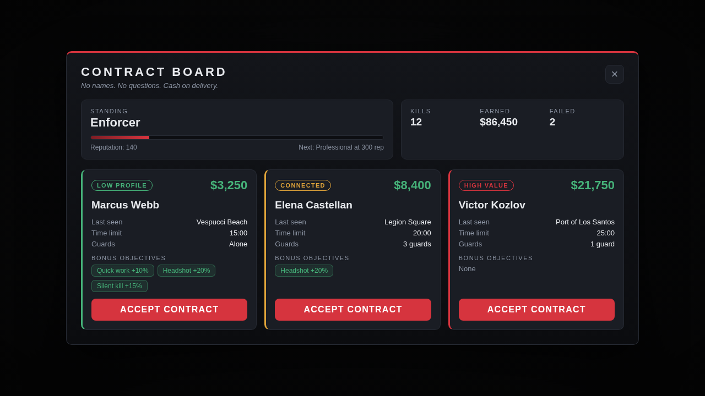

# hitman_npc

A solo hitman job. A contract broker hands out jobs, you hunt an NPC target across the map, kill them and get paid. Reputation unlocks harder, better paying contracts.

<p>
  
  
</p>

## How a job goes

1. Walk up to the broker (a blip shows where) and press **E**. The contract board opens with three offers.
2. Each offer shows the target's name, last known area, payout, time limit, number of guards and optional bonus objectives. Accept one.
3. The map shows a red search circle and a waypoint is set. The target is not there yet: they appear when you get close (about 140 m), standing around with their guards.
4. Get in range and they react. Easy targets run, harder targets and their guards shoot back. Gunfire (unsuppressed) alerts everyone within about 90 m.
5. Kill the target. The server checks the kill and pays you: base payout plus any bonuses you earned.
6. Reputation goes up, you get a cooldown, and the bodies disappear after a minute.

Dying, running out of time or walking away fails the contract and costs reputation. Leaving the server removes the NPCs.

### Difficulty and reputation

| Tier | Needs rep | Payout (before level bonus) | Time | Guards | Target |
| --- | --- | --- | --- | --- | --- |
| Low Profile | 0 | $2,500 - $4,000 | 15 min | 0-1 | runs, always marked on the map once spawned |
| Connected | 100 | $6,000 - $9,000 | 20 min | 2-3 | fights back, marked only when close |
| High Value | 300 | $14,000 - $22,000 | 25 min | 4-6 | armed and armoured, marked only when close |

Standing (Rookie, Enforcer, Professional, Ghost) multiplies payouts by 1.0 / 1.1 / 1.25 / 1.4. Finished jobs give +15 / +30 / +60 reputation. Failing costs 10, abandoning 5.

### Bonus objectives

Each offer may carry any of these. They are listed on the card before you accept.

| Bonus | Condition | Extra |
| --- | --- | --- |
| Headshot | the killing blow hits the head | +20% |
| Silent kill | suppressed weapon or melee | +15% |
| Quick work | finished within half the time limit | +10% |

## Installation

1. Put the `hitman_npc` folder in `resources`.
2. `ensure hitman_npc` in `server.cfg`, after your framework.
3. Optional staff commands: `add_ace group.admin command.hitmannpc allow`.

Needs OneSync for server side kill verification. Without it the script still runs and trusts the client.

## Configuration

Everything is in `config.lua`. The important parts:

| Setting | What it does |
| --- | --- |
| `Framework` | `auto`, `qbcore`, `qbox`, `esx` or `standalone`. |
| `RequireJob` / `JobName` | Restrict the job to a framework job (see below). Off by default, so anyone can do it. |
| `MinPolice` / `PoliceJobs` | Contracts are only handed out while at least this many police are online. |
| `Broker` | Model, position, idle animation and blip of the contract broker. |
| `Locations` | Where targets can appear. Each has a centre, a scatter radius and the tiers allowed there. |
| `Tiers` | Payout range, time limit, guard count and weapons, target behaviour and health per difficulty. |
| `Levels` | Standing names, the reputation they need and their payout multiplier. |
| `Bonuses` / `BonusChance` | Bonus percentages and how often a contract carries each. |
| `Payment` | Account to pay into (`cash`, `bank`, or `black_money` on ESX) and a global multiplier. |
| `Cooldown` / `VoidCooldown` | Wait between contracts, and the shorter wait after a contract is voided through no fault of the player. |
| `Heat` | Chance that a kill is reported, optional wanted level, and the `alert` function for your dispatch. |
| `ServerValidation` / `StrictKillCheck` | How hard the server verifies kills (see below). |
| `Webhook` | Optional Discord log of accepted, completed and failed contracts. |

### Add your own locations

Stand where you want a target to appear and run `/hitmancoords`. Copy the numbers into `Config.Locations`:

```lua
{ label = 'Vinewood Sign', coords = vec3(711.0, 1198.0, 348.5), scatter = 30.0, tiers = { 2, 3 } },
```

The exact spot is picked when the target spawns: the script asks the game for walkable ground near the centre, so you do not need to be precise. If the model or coordinates are bad the contract is voided without penalty and the player may try again.

### Restrict it to a job

Set `RequireJob = true` and make sure the job exists.

**QBCore / Qbox** (`shared/jobs.lua` of the framework):

```lua
['hitman'] = {
    label = 'Hitman',
    defaultDuty = true,
    offDutyPay = false,
    grades = { ['0'] = { name = 'Contractor', payment = 0 } },
},
```

**ESX** (SQL):

```sql
INSERT INTO `jobs` (`name`, `label`) VALUES ('hitman', 'Hitman');
INSERT INTO `job_grades` (`job_name`, `grade`, `name`, `label`, `salary`, `skin_male`, `skin_female`)
VALUES ('hitman', 0, 'contractor', 'Contractor', 0, '{}', '{}');
```

### Alert the police

Edit `Config.Heat.alert`. It runs on the killer's client with the position of the kill, with the probability `Config.Heat.chance`:

```lua
alert = function(coords)
    exports['ps-dispatch']:SuspiciousActivity()
end,
```

`wantedLevel` gives the killer GTA wanted stars instead (or as well).

### Translate it

Copy `locales/en.lua` to `locales/xx.lua`, rename the table to `Locales.xx` and set `Config.Locale = 'xx'`. The page picks up the strings from the same file.

## Commands

| Command | Who | What |
| --- | --- | --- |
| `/cancelhit` | players | Abandon the current contract (costs 5 reputation). |
| `/hitmancoords` | players | Print your position as a `vec4`, for setting up the broker and locations. |
| `/hitmannpc reset <id>` | staff | End a player's contract and clear their cooldown. |
| `/hitmannpc setrep <id> <rep>` | staff | Set a player's reputation. |
| `/hitmannpc give <id> <amount>` | staff | Give cash (handy on `standalone`). |

The staff command needs `add_ace group.admin command.hitmannpc allow`. The server console can always run it.

## How cheating is handled

The server owns the contract. The client never sends an amount, only "I killed the target" with two flags (headshot, silent).

With OneSync the server then checks, for every completion:

* the target was registered when it spawned, near the contract's area, and is a ped;
* the ped is actually dead on the server;
* the player is within `MaxKillDistance` of the body;
* nobody else killed it (a kill by another player voids the contract; with `StrictKillCheck = true` the killer must be positively identified as the player or their vehicle);
* the contract has not expired, and it can only be paid once;
* the headshot and silent flags only count if that bonus was part of the contract, and "Quick work" is judged from the server's own clock.

Every event that changes anything is rate limited. Players are limited to one running contract and a cooldown between contracts.

What this does **not** stop: the NPCs are created by the player's own game, so a modified client that spawns its own ped near the area and kills it can still collect a reward, and it can claim the headshot and silent flags. The checks stop forged events and shortcuts, not a determined cheater. Keep payouts and cooldowns in line with that, and use your usual anti-cheat for the rest.

## Persistence

Reputation, kills and earnings are stored per character in the resource's key-value store (no database). Running contracts are not saved: a restart voids them.

## Troubleshooting

| Problem | Check |
| --- | --- |
| Nothing happens at the broker | Is the framework started before this resource? Is the broker where you think (`/hitmancoords`)? The console prints which framework was found. |
| "Not enough police" | `MinPolice` is above the number of players whose job is in `PoliceJobs`. |
| Target spawns in a bad place | Adjust that location's `coords` and `scatter`. |
| Contract voided right after reaching the area | The server could not see the target ped (it did not replicate in time, or spawned far from the area). Set `Config.Debug = true` and read the server console. |
| Kill does not pay out | Stay close to the body. Check the console for the verification message. |

## Not included

* Weapons. Players bring their own. The script does not touch your inventory.
* Persistence of running contracts across a restart.
* Teams: only the player who kills the target gets the credit.
