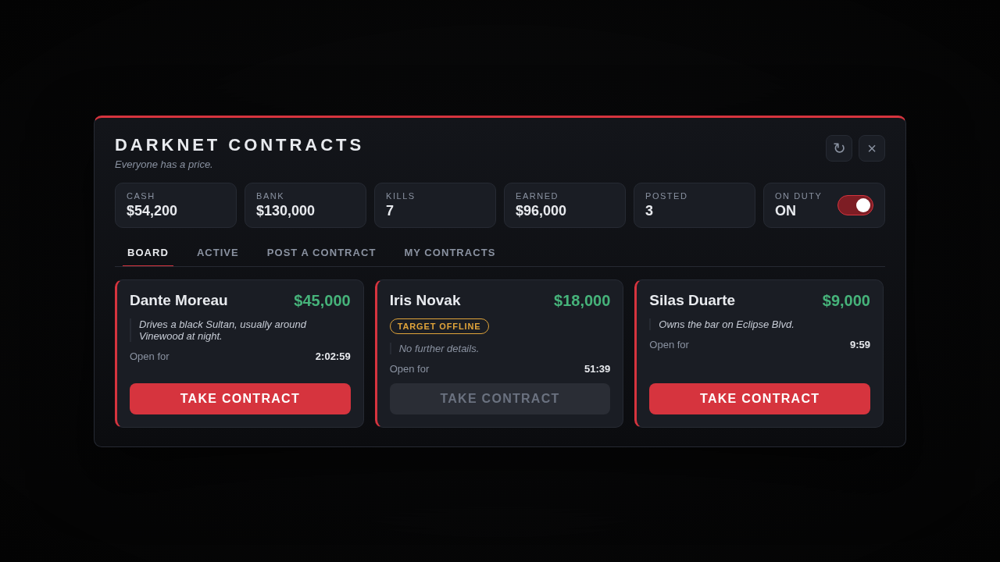
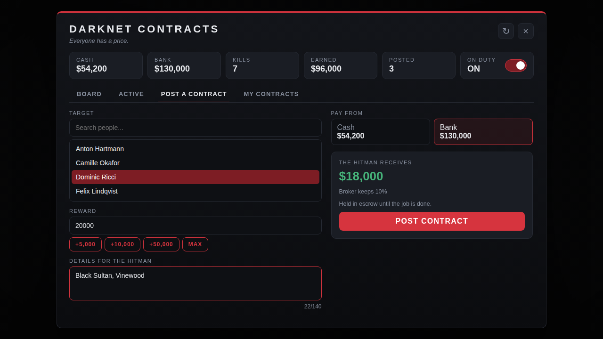

# hitman_players

Players hire hitmen to kill other players. The client posts a contract and pays into escrow, a hitman takes it, hunts the target with a tracker and is paid when the target dies. Nothing is paid out of thin air: the hitman's payout is the client's money, minus the broker's cut.

<p>
  
  
</p>

## How it works

**Posting a contract.** Anyone opens the board (`/hitlist`, a key you bind, or a terminal) and picks *Post a contract*: choose a target, a reward, optional details for the hitman, and whether to pay from cash or bank. The reward leaves the client's account at once and is held in escrow. Contracts are stored on disk, so escrowed money survives restarts and crashes.

**Taking a contract.** Hitmen switch *On duty* (by default anyone can; see `RequireJob`) and see the open contracts. The client stays anonymous. A hitman can hold one contract at a time and cannot take one on themselves or one they posted. Other hitmen cannot take a contract that is already claimed.

**Hunting.** The target gets a vague warning ("someone is hunting you"). The hitman does not see the target's position, only a search area on the map that is refreshed every 30 seconds. The area gets smaller the closer the hitman is, and it is centred off the target so it cannot just be walked to. If the target is offline the signal is lost.

**Payout.** When the target dies, the hitman is paid 90% of the reward in cash. The target is immune from new contracts for 30 minutes.

**When it goes wrong**

| Situation | What happens |
| --- | --- |
| Nobody takes the contract within 3 hours | The client is refunded in full. |
| The client cancels before anyone took it | Refund minus a 10% fee. Once a hitman is on it, it cannot be cancelled. |
| The hitman runs out of time (60 min) | The contract goes back on the board. The hitman cannot take another for 5 minutes. |
| The hitman drops the contract | Same, with the same 5 minute wait. |
| The hitman disconnects | Two minutes to come back and keep it, then it returns to the board. No wait. |
| The client is offline when a refund is due | It is kept as a credit and paid as soon as that character is online again. |
| The framework fails while paying | The money is kept as a credit and retried every minute. |
| Staff remove a contract | The client is refunded in full. |

### The economy

All amounts are defaults in `config.lua`.

| | Default |
| --- | --- |
| Reward range | $5,000 - $250,000 |
| Broker's cut when a contract is fulfilled | 10% |
| Fee for cancelling an open contract | 10% |
| Contracts one person can have posted | 2, with a 5 minute pause between them |
| Targets that cannot be hit | police and ambulance jobs |

## Installation

1. Put the `hitman_players` folder in `resources`.
2. `ensure hitman_players` in `server.cfg`, after your framework, and make sure OneSync is on (`set onesync on`).
3. Optional staff commands: `add_ace group.admin command.hitmanadmin allow`.
4. Players can bind a key for the board in *Settings > Key Bindings > FiveM*. Set `Config.OpenKey` for a default.

On `standalone` (no framework) the script keeps its own wallet. Staff can fund a player with `/hitmanadmin give <id> <amount>`.

## Opening the board

| Way | Setting |
| --- | --- |
| Command | `Config.Commands.board` (default `/hitlist`). Set it to `false` to remove it. |
| Key | `Config.OpenKey`, or the player binds one. |
| Terminals | `Config.Terminals`. With `Config.RequireTerminal = true` the board only works next to one. |

A terminal looks like this. Stand where you want it and run `/terminalcoords`:

```lua
Config.Terminals = {
    { label = 'Back room', coords = vec3(-1172.3, -1571.1, 4.7), radius = 2.0, blip = false },
}
```

The server checks the distance too, so the terminal rule cannot be skipped from the client.

## Configuration

Everything is in `config.lua`.

| Setting | What it does |
| --- | --- |
| `Framework` | `auto`, `qbcore`, `qbox`, `esx` or `standalone`. |
| `RequireJob` / `JobName` | Only players with this framework job may go on duty. Off by default. |
| `Contracts.minReward` / `maxReward` | Allowed reward range. |
| `Contracts.accounts` / `payoutAccount` | Accounts a client may pay from, and where the hitman is paid. |
| `Contracts.brokerCut` / `cancelFee` | The two money sinks, in percent. |
| `Contracts.expireAfter` / `claimTime` | Minutes an open contract lives, and how long a hitman has once he took it. |
| `Contracts.abandonCooldown` / `disconnectGrace` | Seconds. |
| `Contracts.immunity` | Minutes a target is safe after being killed on contract. |
| `Contracts.targetSelection` | `list` shows online players. `input` makes the client type a server id or the exact character name, which suits servers that do not want everyone to see who is online. |
| `Contracts.protectedJobs` | Jobs that cannot be targeted. |
| `Contracts.warnTarget` | `claimed` (when a hitman takes it), `placed` (when it is posted) or `never`. |
| `Contracts.notifyHitmen` | Alert hitmen on duty when a new contract appears. |
| `Tracker` | Update interval, smallest and largest search radius, and whether to set a waypoint. |
| `Webhook` | Optional Discord log of every contract event. |

### Restrict it to a job

Set `RequireJob = true` and create the job.

**QBCore / Qbox** (`shared/jobs.lua` of the framework):

```lua
['hitman'] = {
    label = 'Hitman',
    defaultDuty = true,
    offDutyPay = false,
    grades = { ['0'] = { name = 'Contractor', payment = 0 } },
},
```

**ESX** (SQL):

```sql
INSERT INTO `jobs` (`name`, `label`) VALUES ('hitman', 'Hitman');
INSERT INTO `job_grades` (`job_name`, `grade`, `name`, `label`, `salary`, `skin_male`, `skin_female`)
VALUES ('hitman', 0, 'contractor', 'Contractor', 0, '{}', '{}');
```

Anyone can still *post* a contract. `RequireJob` only decides who may take them.

### Translate it

Copy `locales/en.lua` to `locales/xx.lua`, rename the table to `Locales.xx` and set `Config.Locale = 'xx'`. The page uses the same file.

## Commands

| Command | Who | What |
| --- | --- | --- |
| `/hitlist` | players | Open the board. |
| `/hitduty` | players | Toggle *On duty*. |
| `/terminalcoords` | players | Print your position as a `vec3`. |
| `/hitmanadmin list` | staff | List contracts. |
| `/hitmanadmin cancel <id>` | staff | Remove one contract and refund the client in full. |
| `/hitmanadmin clear` | staff | Remove every contract and refund everyone. |
| `/hitmanadmin give <id> <amount>` | staff | Give cash (handy on `standalone`). |

The staff command needs `add_ace group.admin command.hitmanadmin allow`. The server console can always run it.

## How kills are verified, and what that cannot prove

A player's death can only be observed reliably by that player's own game: frameworks revive the dead into a "downed" state within about a tenth of a second, so the server cannot check health after the fact. So the **target's client reports the death** and who killed them (checked every frame, like FiveM's own `baseevents`).

The server pays only if all of these hold:

* the reporting player is the target of a contract that a hitman has claimed;
* the named killer is exactly that hitman, and they are online;
* by the server's own player positions, killer and target are within `maxKillDistance` of each other;
* the contract has not been paid already.

Reports are rate limited. Money can only move from the client's escrow to the hitman, never be created, so a forged report gains nothing from the economy.

What this **cannot** prevent: a target and a hitman who work together can fake a kill and take the client's money, because nothing can prove a death to a third party. The Discord log (`Webhook`) names the hitman, the client and the amounts on every payout, so staff can spot the same pair showing up again and again. Only the hitman himself is credited with a kill, never a partner.

## Persistence

Contracts, pending credits, immunity and statistics are kept in the resource's key-value store, so there is no database to set up. Look in `server/store.lua` if you want to move them elsewhere. After a restart, claimed contracts get the disconnect grace period so the hitman can come back.

## Troubleshooting

| Problem | Check |
| --- | --- |
| The board does nothing | The console shows which framework was found. Is it started before this resource? |
| "OneSync is disabled" in the console | The tracker needs player positions. Add `set onesync on`. |
| A hitman is never paid | The target's death was not seen by the target's game, or the two players were further apart than `maxKillDistance`. Set `Config.Debug = true`. |
| Nobody can use the board | `RequireTerminal` is on but `Terminals` is empty, or the player is not near one. |
| Money seems missing | Look for a pending credit: it is paid when the owner is online, and retried every minute. `/hitmanadmin list` shows open contracts. |

## Not included

* A kill by a partner does not pay the hitman who took the contract.
* No inventory or item integration: nothing is given to the players except money.
* Stats are per character but there is no leaderboard.
